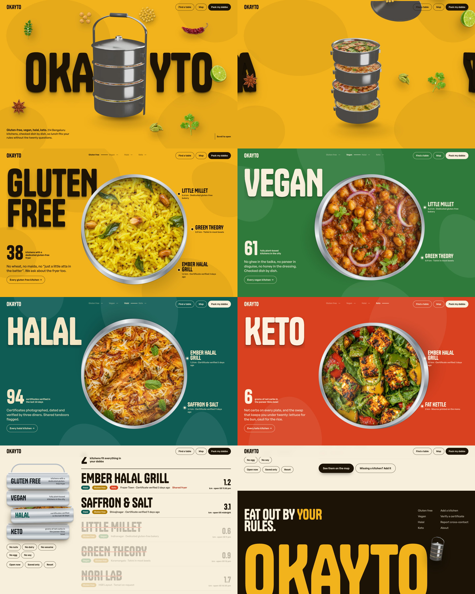
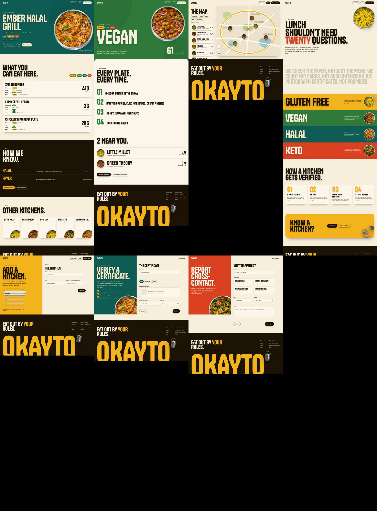
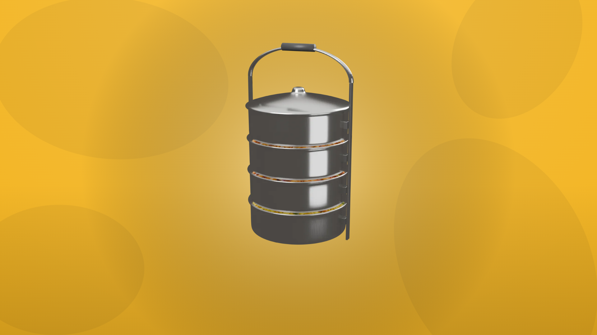

# Okayto

A front-end restaurant guide for people who eat gluten-free, vegan, halal or keto. The site uses a steel tiffin as a scroll story, then lets visitors stack dietary rules in the “Pack your dabba” finder.

[Open the live site](https://vaibhavcr09.github.io/okayto/)

## Pages

| Page | What it does |
| --- | --- |
| Home (`index.html`) | A scroll-controlled tiffin animation and a finder with dietary rules, allergen exclusions, open-now and saved-kitchen filters. Matching kitchens rise to the top. |
| Kitchen (`restaurant.html`) | Restaurant details, dish-by-dish diet verdicts, suggested swaps, example verification notes and a shareable kitchen card. |
| Diet (`diet.html`) | Explains one dietary category, its checks and matching example kitchens. |
| Map (`map.html`) | A stylised map of the example Bengaluru kitchens, with filters and selectable restaurant cards. |
| Add a kitchen (`add.html`) | A four-step demonstration form for suggesting a restaurant. |
| Verify (`verify.html`) | A demonstration form for recording a certificate check and previewing a photo. |
| Report (`report.html`) | A demonstration form for reporting a cross-contact concern. |
| About (`about.html`) | Explains the guide's idea and its example verification process. |

The four diets are **gluten-free**, **vegan**, **halal** and **keto**. Saved kitchens are kept in the current browser.

## Preview







## Technology

Plain HTML, CSS and JavaScript. There is no package installation or build step. Asset paths are relative so the files can be served directly from the repository root on GitHub Pages.

- GSAP and ScrollTrigger for the scroll animation.
- Lenis for smooth scrolling.
- 180 WebP frames of a steel tiffin rendered in Blender, with `frames/tiers.js` for positioning.
- Tanker and General Sans fonts from Fontshare, used under its free licence.
- Local food images and a shared JavaScript dataset.

## Run locally

Open `index.html` in a browser, or serve the folder with Python:

```sh
python3 -m http.server 8000
```

Then open [http://localhost:8000](http://localhost:8000). Keep all folders beside `index.html`; the animation needs the files in `frames/`, and the fonts are in `fonts/`.

## Example data

All restaurant names, dietary claims, certificates, addresses, menu details and other restaurant records are fictional example data. The forms are simulated, send nothing and do not create real restaurant submissions or verification reports. This is a front-end demonstration, not a real restaurant directory or dietary-safety certification service.

## GitHub Pages

The live site is published from the `main` branch and repository root. `index.html` sits at the top level. No environment variables, API keys or backend are required.
